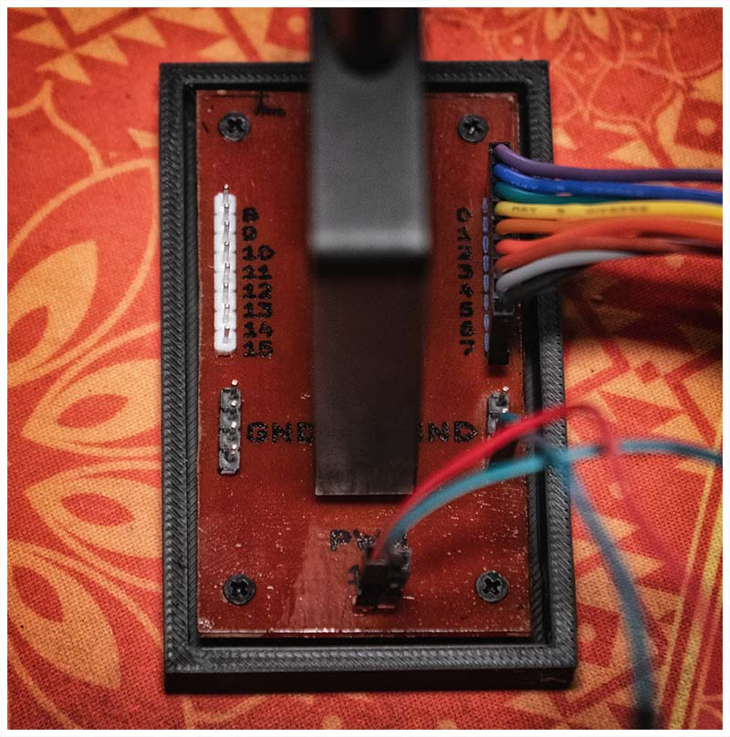
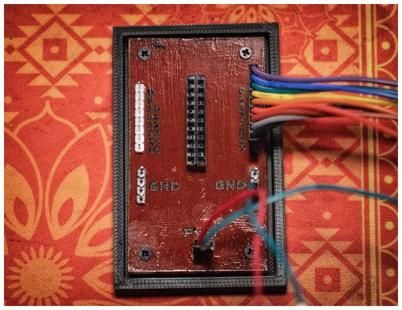
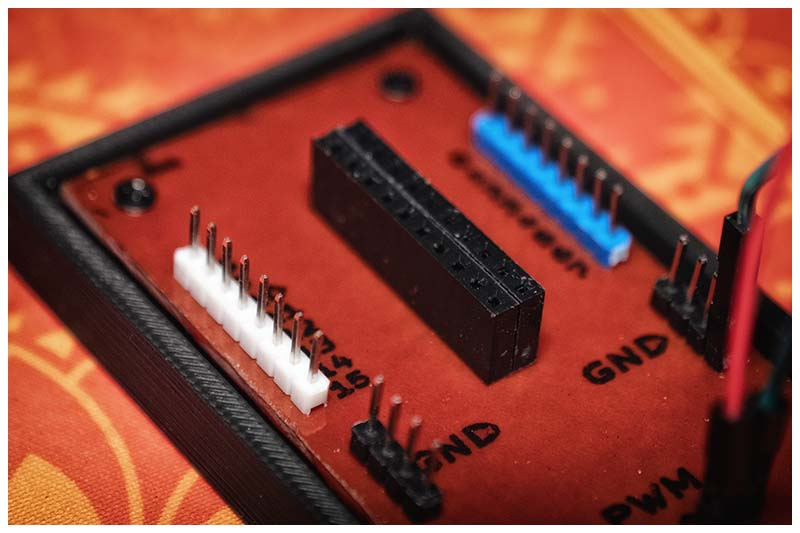

# Alientek DL16 (Plus) Connection Board

This project is a small adapter board for the Alientek DL16 (Plus) logic analyzer, which I find more convenient than the cables that come with the device.

It’s a single-sided PCB housed in a half-size enclosure. I used the top side (F-Cu) for the markings.

To make the PCB, I used the iron-on transfer technique with a laser printer. First, I transferred the B-Cu layer. Then I etched the PCB with iron perchloride. Next, I drilled the holes, then transferred the F-Cu (the labels) onto the front side. I soldered the connectors, then applied a protective coating to both sides.

For the half-case, I used brass thermal inserts and 4mm M2 screws.

This was a project I completed very quickly; it took just 3 hours from the initial idea to completion.

[Connectors](https://www.aliexpress.com/item/4000873858801.html)

[Alientek DL16 (Plus)](https://en.alientek.com/Product_Details/44.html)
